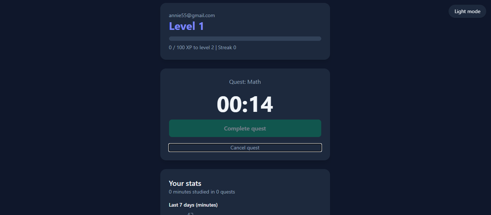
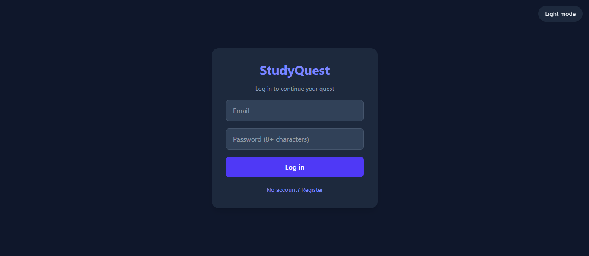
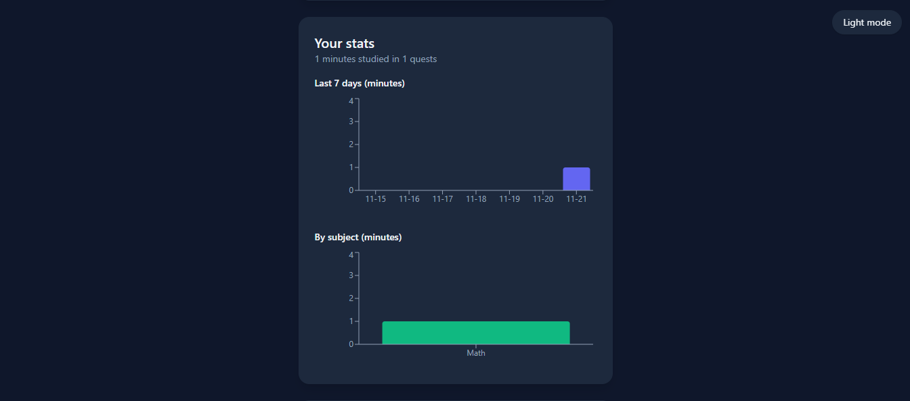
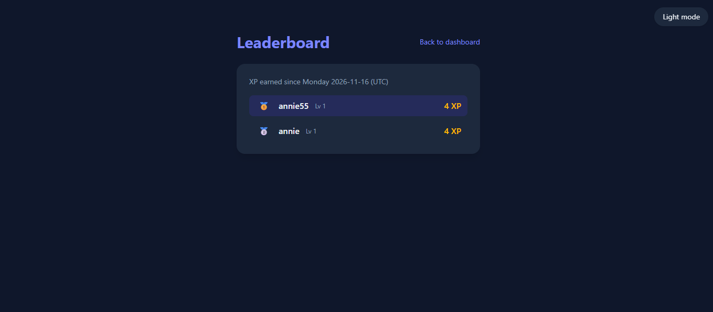
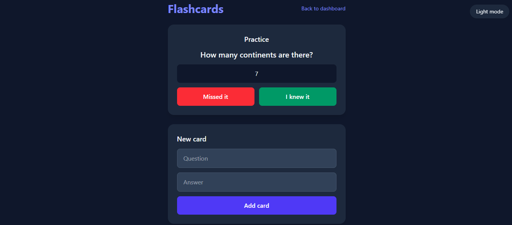
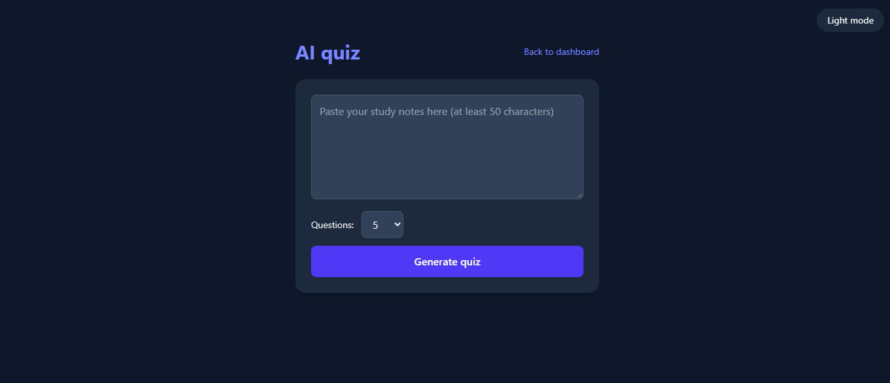
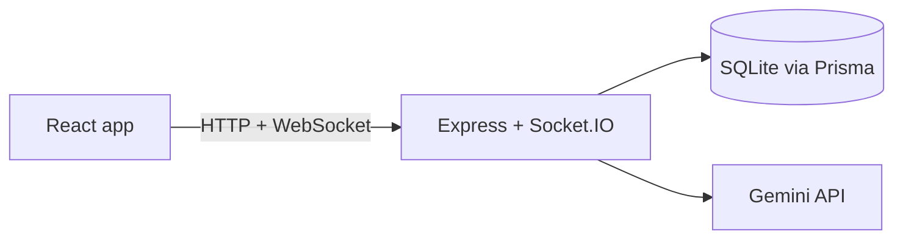

# StudyQuest

A gamified study platform. Focus on a subject with a timer, earn XP, level up, keep a daily streak, unlock badges, study with friends in live rooms, and practise with flashcards or an AI-generated quiz.



## Features

- **Accounts:** register and log in with JWT authentication and bcrypt-hashed passwords
- **Quest timer:** the server records the start time and checks the real elapsed time before awarding XP, so the timer can't be faked from the browser
- **XP and levels:** 2 XP per minute plus a streak bonus, with a level curve that grows gradually
- **Daily streaks and badges:** First Quest, On Fire, Level 5 and Marathon
- **Live study rooms:** real-time presence and chat with Socket.IO
- **Weekly leaderboard:** ranking by XP earned this week
- **Charts:** minutes studied per day and per subject (Recharts)
- **Flashcards:** create your own cards; cards you miss come up more often
- **AI quiz:** turn pasted notes into multiple-choice questions (Google Gemini, free tier)
- **Dark mode** and a responsive layout

## Screenshots

| Login | Study room |
|---|---|
|  |  |

| Stats | Leaderboard |
|---|---|
|  |  |

| Flashcards | AI quiz |
|---|---|
|  |  |

## Tech stack

| Layer | Technology |
|---|---|
| Frontend | React, TypeScript, Vite, Tailwind CSS, Recharts |
| Backend | Node.js, Express, TypeScript, Socket.IO |
| Database | SQLite with Prisma ORM |
| Validation | Zod |
| Auth | JWT, bcryptjs |
| AI | Google Gemini API (called from the backend only) |
| Tests and CI | Vitest, GitHub Actions |

## Architecture



The browser never talks to the AI directly, so the API key stays on the server.

## Getting started

You need [Node.js](https://nodejs.org) (LTS) and [Git](https://git-scm.com).

```bash
git clone https://github.com/oumnia-ktiri/studyquest.git
cd studyquest
```

**1. Backend**

```bash
cd apps/api
npm install
cp .env.example .env        # on Windows PowerShell: copy .env.example .env
npx prisma migrate deploy
npx prisma generate
npm run dev
```

Open `apps/api/.env` and set `JWT_SECRET` to a long random text. `GEMINI_API_KEY` is optional: without it the quiz page shows a "not configured" message and the rest of the app works.

**2. Frontend** (in a second terminal)

```bash
cd apps/web
npm install
npm run dev
```

Open http://localhost:5173 and register an account.

## Tests

```bash
cd apps/api
npm test
```

## Design decisions

- **Server-side XP:** the client only displays the countdown. The server stores `startedAt` and refuses to complete a quest early.
- **Presence:** rooms live in server memory, and a user is removed when their socket disconnects, including unexpected drops.
- **AI isolation:** quiz generation goes through the backend, with input validation, output validation (Zod) and a per-user rate limit.

## Known limitations

- Room presence and chat are kept in memory, so they reset when the server restarts, and chat is not saved.
- Streak days use UTC, not the user's local time zone.
- The "studying" label in a room is read when someone joins.

## License

MIT